# 🚀 DEVIXO Solutions — Task 01: Professional Personal Portfolio Website

[](https://imtiazaly.github.io/DEVIXO_Personal-Portfolio-Website/)


-purple?style=for-the-badge)

---

## 📌 Project Overview & Metadata

- **Live Deployment URL:** 🌐 [https://imtiazaly.github.io/DEVIXO_Personal-Portfolio-Website/](https://imtiazaly.github.io/DEVIXO_Personal-Portfolio-Website/)
- **Company / Organization:** DEVIXO SOLUTIONS
- **Internship Domain:** Web Development
- **Task Number:** Task 01 — Professional Personal Portfolio Website
- **Student / Candidate Name:** Imtiaz Ali (Imtiaz Aly)
- **Role:** Full-Stack & Mobile App Developer | BS Software Engineering (VU)
- **Objective:** Architect a modern, production-ready, fully responsive personal portfolio from scratch using 100% pure handcrafted HTML5, CSS3, and Vanilla JavaScript—designed to win the DEVIXO Top Performer Award.

---

## 🎯 Task Objective

The core objective of this project is to showcase verified technical proficiency, real-world industry experience, and academic milestones through a sleek, accessible, and high-performance digital portfolio. Built with zero external UI libraries or CSS frameworks, the website emphasizes:
1. **Semantic HTML5** architecture and accessibility (ARIA standards).
2. **Modular CSS3** design token system with dynamic Dark/Light theme switching.
3. **Vanilla JavaScript** interaction logic (active navigation tracking, interactive skills showcase with hover-pause, and persistent theme storage).
4. **Fluid Responsiveness** engineered with CSS Grid and Flexbox across all viewport breakpoints (Mobile, Tablet, Laptop, and 4K Ultra-Wide).

---

## 🛠️ Technologies Used

| Technology | Purpose & Implementation |
| :--- | :--- |
| **HTML5 (Semantic)** | Semantic page structuring (`<header>`, `<nav>`, `<main>`, `<section>`, `<article>`, `<footer>`), SEO metadata, and accessible ARIA attributes. |
| **CSS3 (Custom Tokens)** | Modern CSS custom properties (`--tokens`), CSS Grid, Flexbox, GPU-accelerated micro-animations (`@keyframes morph`, `@keyframes float`), and Glassmorphism effects. |
| **Vanilla JavaScript (ES6+)** | Theme state persistence via `localStorage`, dynamic mobile navigation drawer, scroll-spy navigation highlighting, and auto-cycling interactive skill tabs. |
| **SVG Icons** | Crisp, scalable, zero-latency vector icons for social media and technology badges. |

---

## 🌟 Key Website Features

1. **🌗 Intelligent Dual Theme System:**
   - Seamless toggling between high-contrast Dark and Light modes.
   - User preference automatically saved in `localStorage` and respected across reloads.
2. **⚡ Hero Section with Real Profile Avatar:**
   - Real developer portrait embedded inside a dynamic CSS-animated morphing gradient frame.
   - Live availability badge (`Full-Stack Developer @ Softleed Company`) and verified social links (GitHub, LinkedIn, Email).
3. **📖 Authentic About Me Section:**
   - Deep narrative connecting 8-year classical logic and linguistic research (*Shahadat-ul-Alamiya / HEC 16-Year Master's Equivalent*) with real enterprise software engineering at *Softleed Company*.
   - 4 verified stat cards (59+ Engineered Apps, 1.5+ Yrs Industry Experience, 7+ Company Production Apps, 100% Handcrafted Code).
4. **🎛️ Interactive Skills Showcase:**
   - 16 core technologies categorized into 4 automated showcase tabs:
     - *Frontend & 3D Web* (React, Next.js, Three.js, Tailwind)
     - *Backend & Systems* (Laravel, Node.js, Express, PHP)
     - *Databases & Real-Time* (PostgreSQL, MySQL, WebSockets, Prisma)
     - *Mobile & DevOps* (React Native, Playwright QA, Docker, Git)
   - Auto-cycling preview with hover-to-pause inspection.
5. **🎓 4-Level Academic Timeline (Reverse-Chronological):**
   - **Jan 2026 — Present:** BS Software Engineering (BSSE) at *Virtual University of Pakistan* (2nd Semester).
   - **2021 — 2025:** M.A. in Islamic Studies & Arabic (*Shahadat-ul-Alamiya* - HEC 16-Year Master's Equivalent) at *Jamia Urwat-ul-Wusqa, Lahore*.
   - **2019 — 2021:** Higher Secondary School Certificate (HSSC - Humanities) at *BISE Lahore* (1036/1100 Marks, Grade A+ Distinction).
   - **2017 — 2019:** Secondary School Certificate (SSC - Science) at *Siraat High School / BISE Gujranwala* (848/1100 Marks, Grade A).
6. **💻 Flagship Projects Showcase:**
   - **Astrovia:** 3D Solar System Explorer & AI Copilot (React 19, Three.js, Cloudflare AI).
   - **MarketNest:** Multi-Vendor Marketplace Platform (Next.js 16, Tailwind v4, Framer Motion).
   - **Mansooba (منصوبہ):** Multi-Tenant Project Management SaaS (React 18, Prisma ORM, Socket.io).
   - High-definition project thumbnails with hover-zoom micro-interactions and live demo links.
7. **📬 Contact Section & Footer:**
   - Handcrafted functional contact form with input validation and quick-connect channels.
   - Semantic footer with quick navigation links and intellectual property rights.

---

## 📂 Project Structure

```text
DEVIXO_Personal-Portfolio-Website/
├── index.html              # Main semantic HTML5 structure
├── style.css               # Production CSS3 styles & design tokens
├── script.js               # Vanilla JavaScript interaction logic
├── LICENSE                 # Project open-source license
├── README.md               # Comprehensive project documentation
├── PDF_Report/             # Official submission PDF report documentation
└── images/                 # Optimized graphic assets
    ├── profile/            # Real candidate avatar & profile photography
    │   ├── rtl2.png
    │   └── rtlrembg.png
    ├── projects/           # High-resolution project showcase screenshots
    │   ├── Astrovia.png
    │   ├── Mansooba.png
    │   └── MarketNest.png
    └── screenshoots/       # Complete visual audit for submission review
        ├── project1.PNG    # Desktop: Home / Hero Section
        ├── project2.PNG    # Desktop: About Me Section
        ├── project3.PNG    # Desktop: Skills Showcase Section
        ├── project4.PNG    # Desktop: Academic Journey (Education)
        ├── project5.PNG    # Desktop: Projects Showcase
        ├── project6.PNG    # Desktop: Contact Section
        ├── project7.PNG    # Desktop: Footer & Copyright
        ├── m-project1.PNG  # Mobile: Hero Section View
        ├── m-project2.PNG  # Mobile: Navigation & About Section
        ├── m-project3.PNG  # Mobile: Skills View
        ├── m-project4.PNG  # Mobile: Education Timeline
        ├── m-project5.PNG  # Mobile: Featured Project 1
        ├── m-project6.PNG  # Mobile: Featured Project 2
        ├── m-project7.PNG  # Mobile: Contact Form
        └── m-project8.PNG  # Mobile: Footer View
```

---

## 📸 Visual Showcase & Screenshots

### 🖥️ Desktop Experience

| Home / Hero Section | About Me Section |
| :---: | :---: |
| 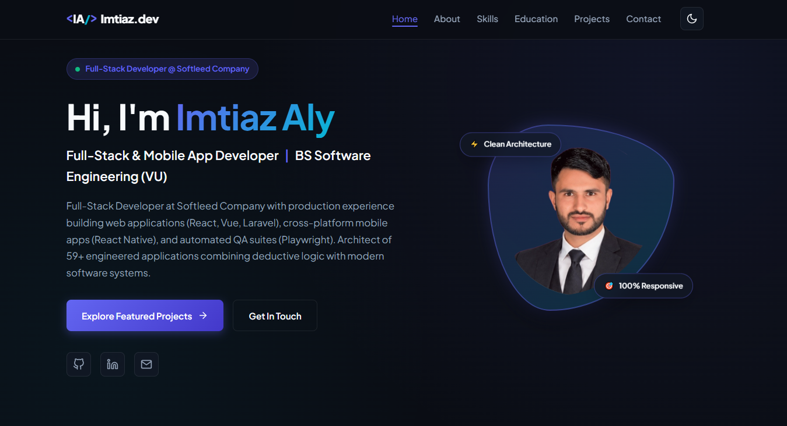 | 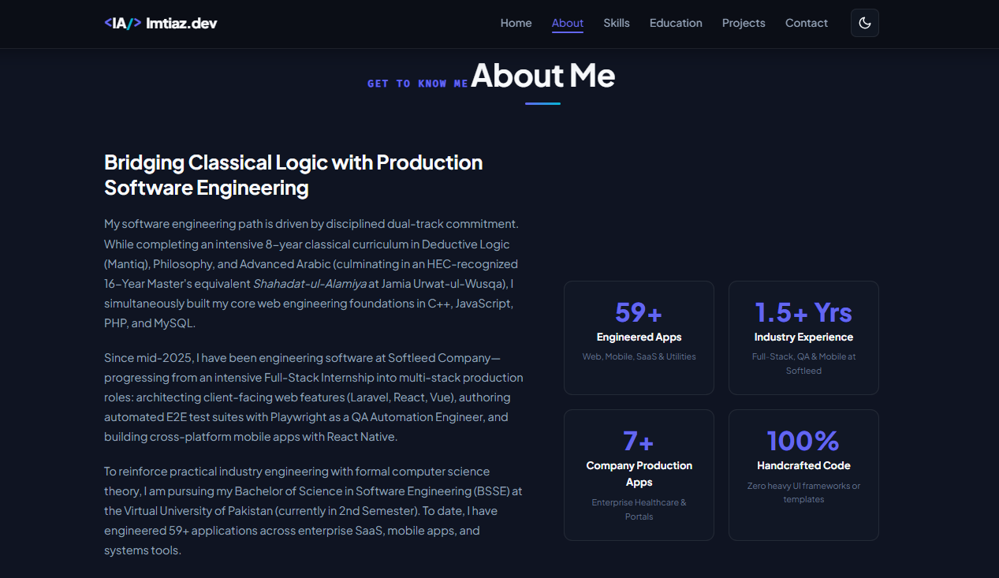 |

| Skills & Expertise | Education Timeline |
| :---: | :---: |
| 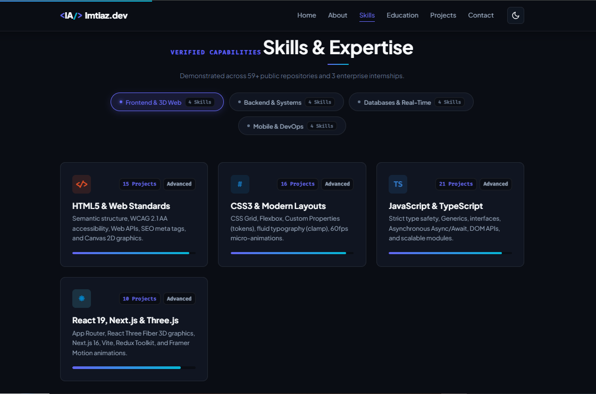 | 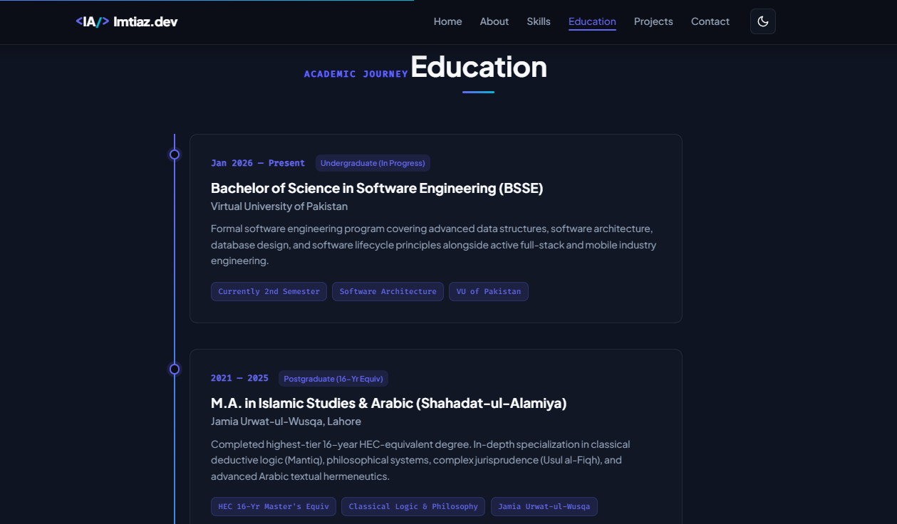 |

| Featured Projects | Contact & Communication |
| :---: | :---: |
| 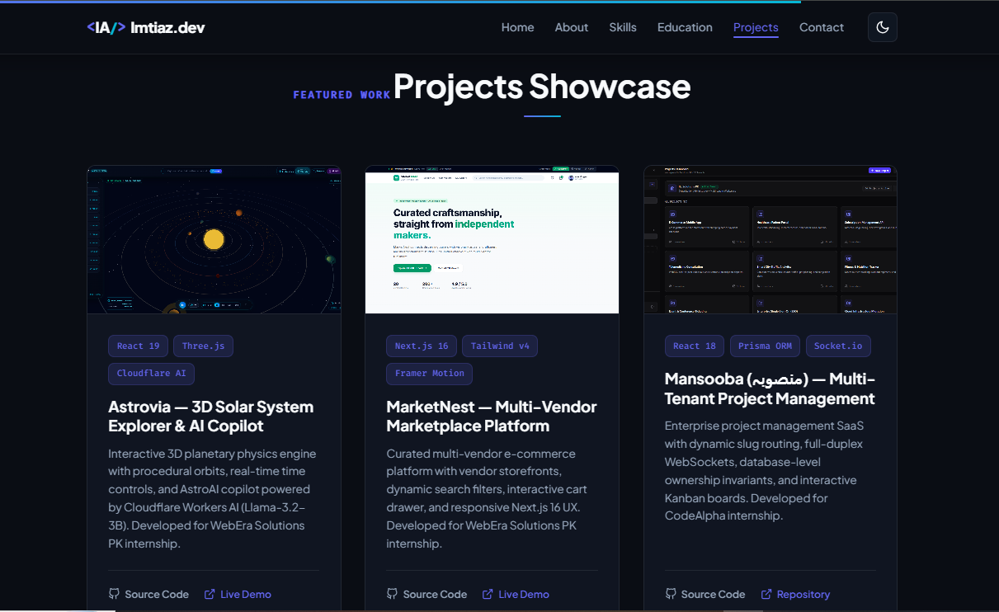 | 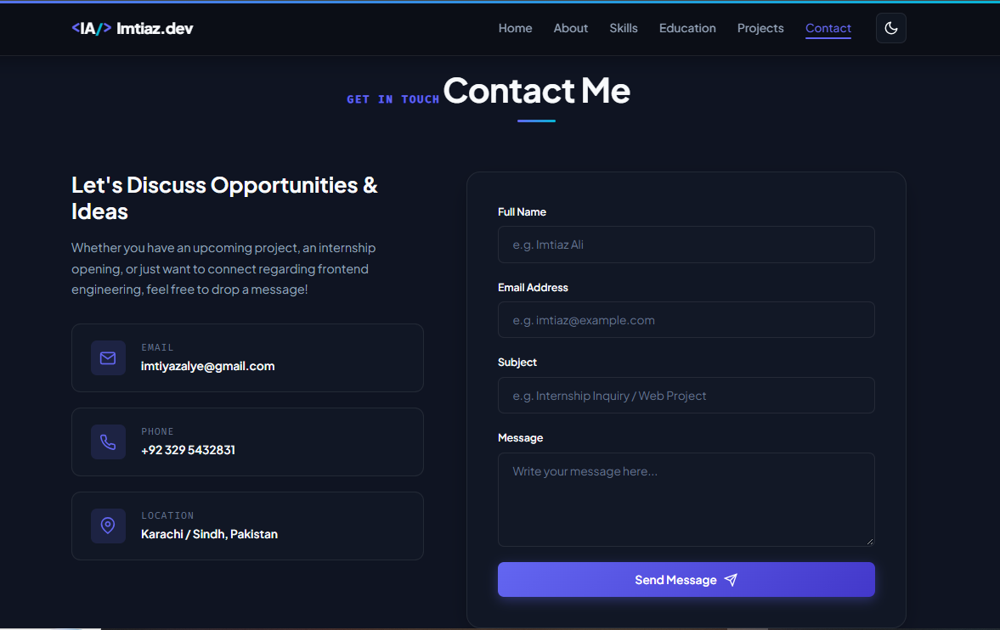 |

---

### 📱 Mobile Experience (Fully Responsive)

| Mobile Hero | Mobile About | Mobile Skills | Mobile Education |
| :---: | :---: | :---: | :---: |
| 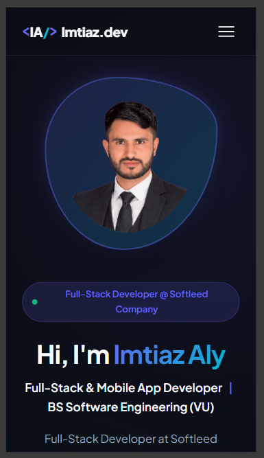 | 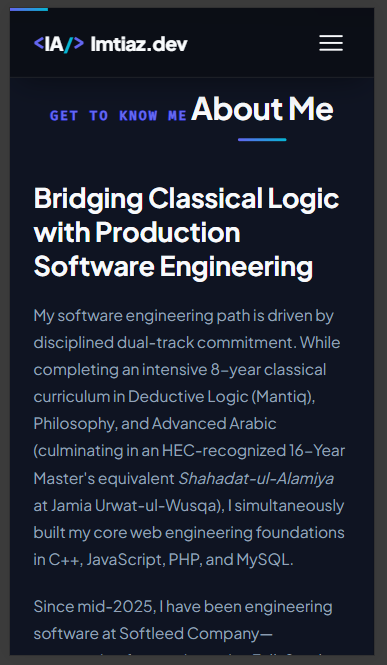 | 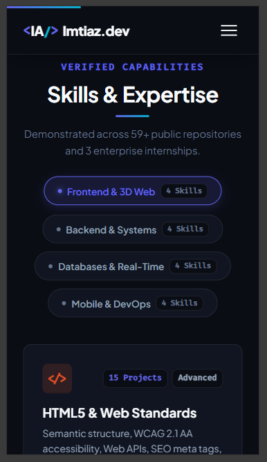 | 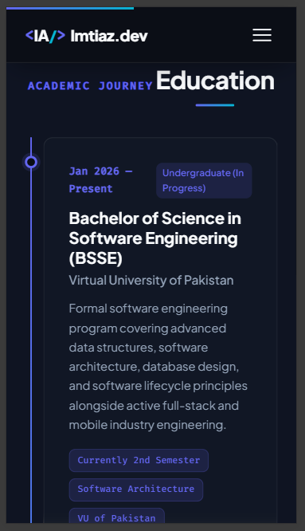 |

| Mobile Project 1 | Mobile Project 2 | Mobile Contact | Mobile Footer |
| :---: | :---: | :---: | :---: |
| 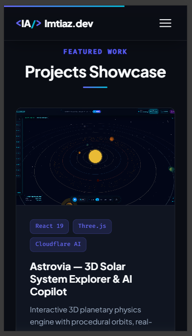 | 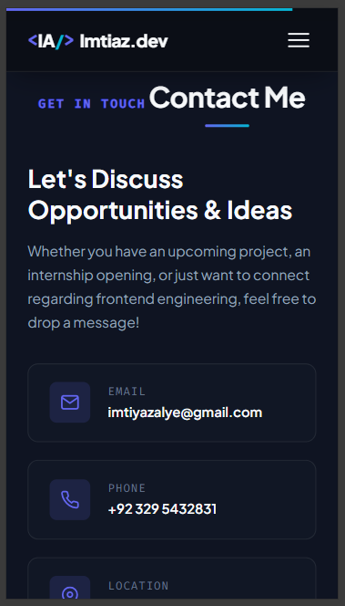 | 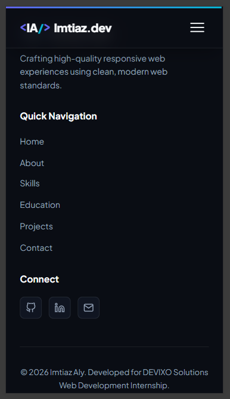 | 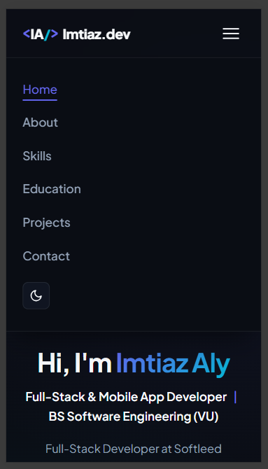 |

---

## 🚀 Instructions for Running the Website Locally

This portfolio website is built using **Pure Vanilla Web Technologies** and requires zero external build dependencies, package managers, or installation commands:

### Method 1: Direct File Launch
1. Clone or download this repository to your local machine:
   ```bash
   git clone https://github.com/imtiazaly/DEVIXO_Personal-Portfolio-Website.git
   ```
2. Navigate into the project directory:
   ```bash
   cd DEVIXO_Personal-Portfolio-Website
   ```
3. Double-click `index.html` to open it directly in any modern web browser (Google Chrome, Microsoft Edge, Mozilla Firefox, Safari).

### Method 2: VS Code Live Server (Recommended)
1. Open the project folder in **Visual Studio Code**.
2. Install the **Live Server** extension (by Ritwick Dey).
3. Right-click on `index.html` and select **"Open with Live Server"**.
4. The website will launch automatically at `http://127.0.0.1:5500/index.html` with real-time reload capability.

---

## 👨‍💻 Author & Contact Information

- **Name:** Imtiaz Ali (Imtiaz Aly)
- **Email:** [imtiyazalye@gmail.com](mailto:imtiyazalye@gmail.com)
- **LinkedIn:** [linkedin.com/in/imtiaz-ali-79476a385](https://www.linkedin.com/in/imtiaz-ali-79476a385/)
- **GitHub:** [github.com/imtiazaly](https://github.com/imtiazaly)

---
*Developed with pride for DEVIXO SOLUTIONS Web Development Internship — Task 01.*